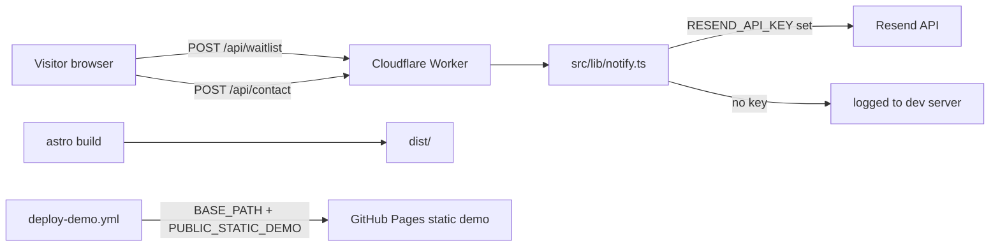

# Example Classes

A coming-soon website for a baby massage and weaning class business. It is built with Astro and deployed to Cloudflare Workers, and includes a waiting-list signup, a demo booking flow and email-sending contact forms.

## Contents

- [What it does](#what-it-does)
- [Quick start](#quick-start)
- [Usage](#usage)
- [Configuration](#configuration)
- [How it works](#how-it-works)
- [Status, limits and real results](#status-limits-and-real-results)
- [Roadmap](#roadmap)
- [Licence and credits](#licence-and-credits)

## What it does

- Shown on the home page: a hero, two class cards and a waiting-list form that posts to `POST /api/waitlist` (`src/pages/index.astro`, `src/components/WaitingListForm.astro`).
- Two course pages driven entirely by content in `src/config.ts`: Baby Massage at £60 for a four-week block (~90 minutes per class) and the Weaning Workshop at £25, online. Each page lists what to expect, benefits and a full curriculum (`src/pages/baby-massage.astro`, `src/pages/weaning-workshop.astro`).
- A demo booking wizard with three steps — class, date and time, then details — that includes a month calendar, per-class time slots (examples in `src/pages/book.astro`) and a free Baby Massage Taster option that skips payment.
- A contact page whose form posts to `POST /api/contact`; submissions are emailed through Resend (`src/pages/contact.astro`, `src/pages/api/contact.ts`, `src/lib/notify.ts`).
- A responsive layout with a collapsing mobile menu and the sage, coral, gold and ivory design system defined in `src/styles/global.css`.
- A GitHub Actions workflow that builds a base-path static demo for GitHub Pages with the forms in demo mode (`deploy-demo.yml`).

## Quick start

Prerequisites: **Node 22.23.4 or later** and npm.

```sh
npm install
npm run dev
```

Open `http://localhost:4321`. You should see the home page with the waiting-list card; submitting the form returns a success message (see [Usage](#usage) for what happens without email configuration).

## Usage

Run the dev server:

```sh
npm run dev
```

Useful commands:

```sh
npm run check        # run the TypeScript + Astro checks
npm run dev -- --host 127.0.0.1 --port 4321   # dev server on a specific host/port
npm run build        # production build in dist/
npm run preview      # serve the production build
```

The dev server output looks like this:

```
 astro  v7.4.7 ready in 9154 ms
┃ Local    http://127.0.0.1:4321/
15:15:40 watching for file changes...
```

### Forms without email configuration

With no `RESEND_API_KEY` set, both form endpoints still return a success response and log the submission to the dev server, so the flow can be tested end-to-end:

```sh
curl -X POST http://localhost:4321/api/waitlist \
  -H 'Content-Type: application/json' \
  -d '{"name":"Alex","email":"alex@example.com","interest":"both"}'
# => {"ok":true,"message":"Thanks! You're on the list — we'll be in touch when classes open."}
```

The dev server logs:

```
[vite] [notify] RESEND not configured — would send to (no CONTACT_EMAIL):
  subject: New waiting-list signup: Alex
  text: Name: Alex Email: alex@example.com Interest: both
```

Local test submissions are not stored permanently.

### Static demo build

To reproduce the base-path build the GitHub workflow uses:

```sh
BASE_PATH=/astro-class-site/ PUBLIC_STATIC_DEMO=true npm run build
python3 -m http.server 4322 --directory dist/client
```

Then open `http://localhost:4322/astro-class-site/`. Forms in this build show a "Demo only" notice and do not send anything.

## Configuration

Most business content — course names, prices, descriptions, the domain, social links and `comingSoon` mode — sits in `src/config.ts`. The environment variables the code actually reads are:

| Variable | Read in | Default | What it does |
| --- | --- | --- | --- |
| `BASE_PATH` | `astro.config.mjs` | `/` | Base path prefix for assets and links. Set to `/your-repo-name/` when building for GitHub Pages. |
| `PUBLIC_STATIC_DEMO` | `src/components/ContactForm.astro`, `WaitingListForm.astro` | *(unset)* | When `true`, browser forms show a demo-only notice and do not send. |
| `RESEND_API_KEY` | `src/lib/notify.ts` | *(none)* | Resend API key. Without it, form submissions are logged locally and not emailed. |
| `CONTACT_EMAIL` | `src/lib/notify.ts` | *(none)* | Recipient for waiting-list signups and contact enquiries. |
| `FROM_EMAIL` | `src/lib/notify.ts` | `Example Classes <onboarding@resend.dev>` | Email sender. In production use an address on a Resend-verified domain. |

Copy `.dev.vars.example` to `.dev.vars` for local form testing. `.dev.vars` is ignored by Git; never commit real credentials.

## How it works

Astro prerenders the five pages to static HTML and builds the server adapter with `@astrojs/cloudflare`. The two API routes (`src/pages/api/contact.ts` and `src/pages/api/waitlist.ts`) have `prerender = false`, so they run as Cloudflare Worker functions. Submissions go through `src/lib/notify.ts`, which reads the Resend configuration from the environment and calls the Resend API; with no key it logs locally and still returns success. `src/lib/paths.ts` (`withBase`) prefixes every asset and link with the configured `BASE_PATH`, so the same build serves correctly both at `/` locally and at `/repo-name/` on GitHub Pages.



Project structure (key files):

```
astro.config.mjs                Base path config, Cloudflare adapter
wrangler.jsonc                  Cloudflare Workers config, ASSETS binding
src/
  config.ts                     Site content: courses, prices, links, images
  lib/
    notify.ts                   Reads env; sends email via Resend
    paths.ts                    withBase() — base-path-aware asset/link paths
  layouts/Layout.astro          Shared <head>, meta tags, Google Fonts
  components/                   Header, Footer, Logo, contact & waiting-list forms
  pages/                        index, baby-massage, weaning-workshop, book, contact
    api/
      contact.ts                POST contact enquiries
      waitlist.ts               POST waiting-list signups
  styles/global.css             Design system: sage, coral, gold, ivory
public/images/                  Placeholder hero, course and gallery illustrations
email/                          Email theme and subscribe template
tests/                          Dependency-upgrade regression tests
.github/workflows/deploy-demo.yml
```

Fonts are served from Google Fonts (Fraunces and Nunito) in `src/layouts/Layout.astro`.

## Status, limits and real results

Status: pre-launch. `src/config.ts` sets `comingSoon: true`, so the site is a coming-soon demo with a waiting list rather than live booking.

Measured (9 November 2026, local machine, Node 22.23.4):

- `astro build` completes and prerenders all five routes (`/`, `/baby-massage`, `/book`, `/contact`, `/weaning-workshop`).
- Dev server starts and serves `/` and `/book` with a 200 status.
- `POST /api/waitlist` and `POST /api/contact` return `{"ok":true,...}` and log locally when `RESEND_API_KEY` is absent.
- No analytics, uptime, accessibility or performance measurements have been run for this site.

Known limits and what it does not do:

- **No real booking.** The booking wizard uses example weekdays and times per class and dates 7–90 days ahead (`book.astro`). Nothing is stored; the confirmation screen states it is a demo.
- **No payment.** The payment button is deliberate: `book.astro` notes the live flow will use GoCardless. No payment or Direct Debit is integrated.
- **Forms**. Without `RESEND_API_KEY`, submissions are neither emailed nor stored.
- **Placeholder images**. `hero.svg`, `baby-massage.svg` and `weaning-workshop.svg` are still placeholders in `public/images/` awaiting real photos.
- **Placeholder links**. The Instagram, Facebook and Google-review URLs in `src/config.ts` are placeholders yet to be set.
- **Domain**. `example.com` is a placeholder; no real DNS or Cloudflare deployment is configured.
- **GitHub Pages**. On 9 November 2026 the Pages API returned 404 for this repo, so the static demo is not live on Pages; the workflow is available to publish it.

## Roadmap

- Replace placeholder domain, social and review URLs and the placeholder images in `src/config.ts`.
- Add real parent testimonials below the home-page class cards (no invented reviews).
- Add genuine availability and a persistent booking store.
- Integrate GoCardless for payment.
- Set `comingSoon: false` only once the live booking flow is ready.

## Licence and credits

No open-source licence is applied; the site and its content are proprietary — all rights reserved.

- Fonts: Fraunces and Nunito, served from Google Fonts.
- Built with [Astro](https://astro.build) and the `@astrojs/cloudflare` adapter; static assets are deployed via Cloudflare Workers.
- Email delivery uses the [Resend](https://resend.com) API.
- Demo booking dates, times, prices and course curricula are example content supplied for this build.
